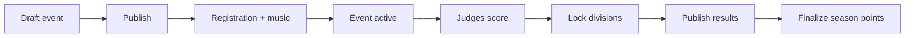
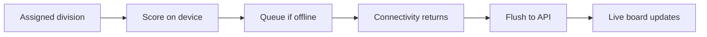
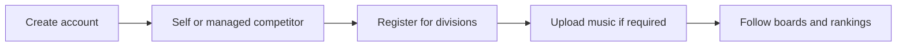

# YoYo League — Product Requirements Document

**Status:** Living document (as-built + near-term roadmap)  
**Owner:** Product  
**Last updated:** 2026-10-11  
**Audience:** Internal (engineering, design, ops). Public summary: `/welcome/product`.

---

## 1. Vision & problem

Competitive yo-yo events still run on fragmented tooling: paper score sheets, shared spreadsheets, ad-hoc livestream chats for standings, and season points tracked out of band. Organizers juggle registration, music, stage ops, and results publishing across tools that do not talk to each other. Judges need a phone-first scoring surface that survives weak venue Wi‑Fi. Competitors and fans expect live boards and season continuity.

**YoYo League** is a Progressive Web App that unifies the contest stack:

**Event ops → floor judging (including offline) → live public boards → published results → season rankings.**

One product, role-aware surfaces, shared competition identity.

---

## 2. Goals & non-goals

### Goals

| Goal | Why it matters |
|------|----------------|
| One installable PWA for organizers, judges, competitors, and fans | Reduce tool sprawl; shareable URLs for boards and profiles |
| Mobile-first judging with offline queue + sync | Floor conditions are unreliable; scores must not be lost |
| Clear trust model for results | Live boards ≠ official published results ≠ season finalize |
| Capability-gated event staff (`/organize`) | Not every staffer is a platform admin |
| Competitor identity separate from login account | Guardians/managers can act for athletes; rankings attach to competitors |
| Public discovery | Rankings, leaderboards, event hubs, player profiles without login |

### Non-goals (explicitly deferred)

| Item | Notes |
|------|-------|
| Stripe / card checkout | Manual QR + receipt verification only today |
| Dedicated head-to-head scoring UI | `head_to_head` enum exists; judge UI falls back to TE/FE clicker |
| SMS notifications | Email + in-app realtime for scores; SMS later |
| Full waiver product workflow | `waiver_status` exists; not a complete waiver experience |
| Guardian invite emails | Multi-competitor / guardian links shipped; invite flow deferred |
| In-app notification center / PWA push | Comms Phase 2 |

---

## 3. Personas & jobs-to-be-done

| Persona | Primary job | Success looks like |
|---------|-------------|--------------------|
| **Platform admin** | Configure seasons, members, rulesets, leagues; unblock ops | Events and staff can run without engineering |
| **Event owner / organizer** | Publish event, staff divisions, run day-of | Registration → scoring → publish → finalize without spreadsheet export |
| **Registration / music / stage staff** | Confirm entries, music, check-in, stage readiness | Capability-scoped `/organize` panels only |
| **Judge** | Score assigned participants quickly and accurately | Large touch targets; drafts; overwrite confirm; offline sync |
| **Head judge** | Lock division, review panel consistency | Lock control + visualiser (outliers / deviation) |
| **Competitor (member)** | Register, submit music, see boards & standing | Self-serve hub; public profile |
| **Guardian / manager** | Register and upload music for managed competitors | Linked competitors with capability flags |
| **Public fan** | Follow live boards and season rankings | No login required for boards / rankings / how-it-works |

---

## 4. Product principles

1. **Mobile-first on the floor** — Judge UI optimizes for one-handed scoring; admin can be denser.
2. **Capability over global role for event ops** — Staff work through `/organize` with `event_staff_roles` capabilities; global `admin` still wins.
3. **Public trust ladder** — Live leaderboard (may hide until lock) → published official results → season finalize (ranking points).
4. **Competitor ≠ account** — Competition identity (`competitors`) links to accounts via relationships (`self` / `guardian` / `manager` / `coach`).
5. **Offline is real for scores** — Queue in IndexedDB; sync with idempotency; show pending state.
6. **Design system fidelity** — Material 3 Expressive (seed `#0B57D0`, Roboto, tonal surfaces). See `.superdesign/design-system.md`.

---

## 5. Current product surface (as-built)

### 5.1 Platform & stack

Next.js App Router · React · TypeScript · Tailwind · Supabase (Auth, Postgres, Realtime, Storage) · PWA (`@ducanh2912/next-pwa`) · deploy target Vercel + Supabase.

### 5.2 Roles

- **Global:** `admin` | `judge` | `member` on `members`
- **Event staff:** owner, organizer, registration_manager, music_manager, head_judge, stage_manager, readonly_staff via `event_staff_roles`
- **Auth gates:** `/admin`, `/judge`, `/member`, `/organize` require login; role/capability checked in pages/APIs

### 5.3 Domains

| Domain | Shipped behavior |
|--------|------------------|
| **Events** | Lifecycle draft → published → active → completed / cancelled; timing, venue, season/tier |
| **Divisions** | Scoring type, rounds, capacity, play order, participants, judges, scoring lock, hide-until-complete, share tokens |
| **Registration** | Statuses incl. waitlist; confirmed → division_members; optional paid-before-confirm |
| **Scoring** | Worlds-style TE clicker + FE; majors; drafts; overwrite confirm; revisions / client submission id |
| **Offline** | IndexedDB queue; auto + manual sync; offline indicator |
| **Leaderboards** | Public hub; tokenized boards; Realtime scores; hide-until-lock |
| **Rankings** | Season points after finalize; filters/search; how-it-works; custom leagues |
| **Music** | Requirements, private uploads, versions, staff review, stage backup/display names |
| **Payments** | Event QR/instructions; receipt upload → staff approve/reject/waive |
| **Comms** | Email outbox (payment, reminders, countdown, blasts, results, lock digest); member opt-outs |
| **Results** | Lock → publish (`results_published_at`) → finalize (season points) |
| **Media** | Curated external links; click-to-load embeds on event hub |
| **Tracks** | Stages + explicit advancement apply (no auto-advance) |
| **Managed competitors** | Create/link; capabilities for register/music/profile |

### 5.4 Key routes

| Audience | Routes |
|----------|--------|
| Public | `/` (marketing when logged out), `/welcome` → `/`, `/welcome/product`, `/login`, `/signup`, `/rankings`, `/leaderboards`, `/leaderboard/[id]`, `/events/[id]`, `/players/[publicId]` |
| Member | `/member/*` (events, registrations, competitors, music, notifications, profile) |
| Judge | `/judge`, divisions, score, queue, completed |
| Admin | `/admin/*` (events, leagues, members, judges, rules, reports, settings) |
| Staff | `/organize`, `/organize/events/[id]` |

---

## 6. User journeys

### 6.1 Organizer contest day

### 6.2 Judge offline

### 6.3 Competitor / guardian

### 6.4 Public fan

Browse `/leaderboards` or `/rankings` → open board or player profile → optional Sign in to see personal standing context.

---

## 7. Requirements

### Must (shipped or required to stay true)

- [x] Role dashboards and protected route groups
- [x] Event + division CRUD and staff capabilities
- [x] Registration with capacity/waitlist and confirm sync
- [x] Judge scoring (TE/FE clicker) with lock + visualiser for head judges
- [x] Offline score queue + sync
- [x] Public live leaderboards (Realtime) + hide-until-complete
- [x] Publish results distinct from live boards; finalize → ranking points
- [x] Music submission + staff ops
- [x] Manual payment receipts
- [x] Email outbox + member notification preferences
- [x] Competitor identity model (links + managed competitors)
- [x] PWA installability

### Should (quality / polish)

- [x] M3 Expressive tokens + Roboto on marketing and app chrome (design branch baseline)
- [ ] Consistent page-shell loading for leaderboards hub (known gap)
- [ ] Custom league naming beyond placeholder copy
- [ ] Richer admin Settings (today mostly status/info)

### Later (roadmap)

- [ ] Stripe or equivalent card pay
- [ ] Dedicated H2H scoring UI
- [ ] Guardian invites
- [ ] Waiver workflow productization
- [ ] In-app notification center + PWA push (+ optional SMS)
- [ ] Authenticated design audit pass for admin/judge/member shells

---

## 8. Success metrics

| Metric | Proxy / definition | Target direction |
|--------|--------------------|------------------|
| Time-to-first-score | Minutes from division “active/judging” to first submitted score | Down |
| Offline sync success | % of queued scores flushed without manual intervention | Up (≥99% of queued items) |
| Registration completion | Confirmed entries / started registrations per event | Up |
| Publish latency | Time from last division lock to `results_published_at` | Down |
| Season finalize coverage | Completed events with finalize vs without | Up |
| Public engagement | Unique visitors to `/leaderboards` + `/rankings` during active events | Up |
| Staff self-serve | % of day-of tasks done in `/organize` without admin escalation | Up |

Instrumentation may start as operational queries / analytics; not all are productized dashboards today.

---

## 9. Risks & dependencies

| Risk | Impact | Mitigation |
|------|--------|------------|
| Supabase RLS recursion on `members` | Broken role checks if using anon client incorrectly | Server role checks via `createAdminClient()` / `is_admin()`; see `docs/RLS_WORKAROUND.md` |
| Email delivery | Missed payment/reminder emails | Resend + cron; console fallback when unset |
| Venue network | Lost scores | Offline queue + idempotent sync |
| Identity model drift | Duplicate athletes / wrong ranking attachment | ADR + migrations; links-only resolution |
| Live vs official confusion | Trust loss | UI copy + publish gate; hide-until-complete |

---

## 10. Roadmap

| Horizon | Focus |
|---------|-------|
| **Now** | Stabilize UX polish; marketing site at `/` (logged-out); keep ops playbook (prompts 17–23) shipped |
| **Next** | Leaderboards loading shell; H2H scoring UI; guardian invites; waiver UX; admin settings depth |
| **Later** | Payments platform; push / in-app notifications; SMS T-1; deeper analytics |

---

## 11. Appendix

### Glossary

| Term | Meaning |
|------|---------|
| **Member** | Login account (`members`) with global role |
| **Competitor** | Competition identity used for enrollment, scores, rankings |
| **Live leaderboard** | Realtime aggregation of included judge scores; may be hidden until lock |
| **Published results** | Official hub results after staff publish |
| **Finalize** | Writes season ranking points from completed contest |
| **Shadow judge** | Training assignment; scores never count toward leaderboard |
| **Capability** | Event-scoped permission from `event_staff_roles` |

### Related docs

- `docs/DEPLOYMENT.md` — greenfield deploy
- `docs/IDENTITY_ADR.md` — competitor identity slices
- `docs/PUBLISHED_RESULTS_ADR.md` — publish pipeline
- `docs/MUSIC_UPLOAD_ADR.md` — music storage
- `docs/PROMPTS_17_PLUS.md` — delivery history 17–23
- `.superdesign/design-system.md` — UI system

### Public product summary

External-facing condensation of this PRD: **`/welcome/product`**.
